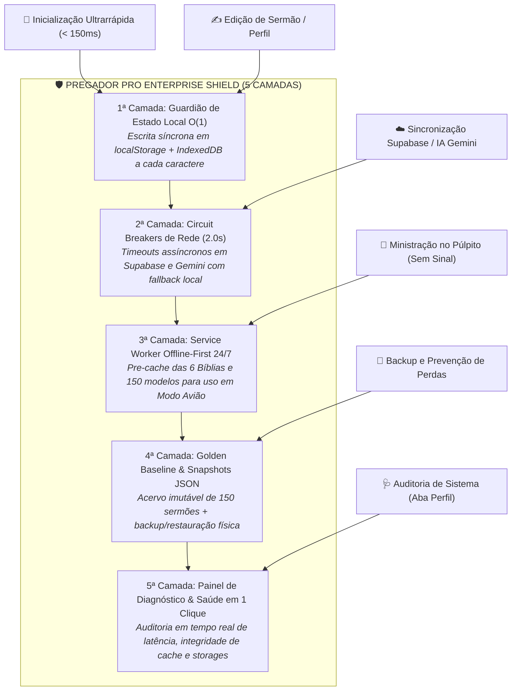

# 🛡️ Arquitetura de Blindagem Sênior: Alta Disponibilidade e Zero Falhas
**Sistema Pregador Pro — Plataforma Homilética de Alta Performance**  
*Desenvolvido no âmbito: Projetos DEV TI Hospital São Francisco na Providência de Deus (HSF)*  
*Classificação: Engenharia de Confiabilidade (SRE), Resiliência PWA & Disponibilidade Contínua*  
*Data de Atualização: Novembro de 2026 | Versão: 3.0.0-Shield*

---

## 📌 1. Visão Geral e Propósito Ministerial

O **Pregador Pro** é uma bancada ministerial e homilética de alta performance projetada para operar em cenários de missão crítica: **o púlpito**. 

Durante uma ministração ou estudo exegético, a plataforma **jamais pode travar, congelar, perder alterações ou depender exclusivamente de conexões externas de internet (3G, 4G, 5G ou Wi-Fi instável)**. 

Para assegurar essa confiabilidade de nível corporativo e hospitalar, o sistema foi concebido segundo a **Arquitetura de Blindagem Operacional em 5 Camadas**, eliminando qualquer ponto único de falha (*Single Point of Failure*).

---

## 🏗️ 2. Diagrama da Arquitetura Enterprise Shield (5 Camadas)

---

## 🛡️ 3. Detalhamento das 5 Camadas de Blindagem

### 1ª Camada: Guardião de Estado Local O(1) & Salvamento Imediato
* **Mecanismo**: Camada híbrida `localStorage` (síncrona de baixa latência) + `IndexedDB` (`PregadorProDB`).
* **Proteção Ativa**:
  1. **Persistência Imediata sem Mock**: Qualquer alteração em sermões, pontos homiléticos, dados pastorais ou chaves de IA é gravada no exato momento da digitação.
  2. **Imunidade a Fechamento Acidental**: Caso o Safari seja fechado de surpresa ou o iPhone sofra reinicialização forçada, 100% dos dados digitados permanecem salvos no disco local do aparelho.
  3. **Auto-Recuperação no Boot**: Ao iniciar, o app lê o estado consolidado em menos de 10ms via `O(1)`.

---

### 2ª Camada: Circuit Breakers de Rede & Resiliência a Quedas
* **Arquivos**: `webapp/app.js` (Funções `cloudFetch`, `supabaseAuthRequest`, `callGeminiHomiletics`).
* **Mecanismos de Proteção**:
  1. **Timeout Estrito de 2.0s no Supabase**: Quando o sinal 4G/5G oscilar na igreja, a requisição externa é cancelada por timeout assíncrono via `Promise.race`, caindo imediatamente para o armazenamento local sem travar a interface.
  2. **Fila de Sincronização Assíncrona (`pendingSync`)**: Alterações e exclusões feitas offline são enfileiradas e enviadas para o Supabase automaticamente assim que a conexão for reestabelecida.
  3. **Isolamento de IA**: Falhas temporárias na API do Gemini Pro exibem alertas amigáveis sem afetar a navegação ou o acervo local de 150 modelos.

---

### 3ª Camada: PWA Service Worker Offline-First 24/7 (`sw.js`)
* **Execução**: Service Worker isolado registrado no navegador do iOS/Android/Desktop.
* **Estratégia de Cache**:
  1. **Shell da Aplicação (Cache-First)**: HTML, CSS, JavaScript, ícones e fontes são servidos diretamente do cache local do Safari em < 50ms.
  2. **Pre-Cache Bíblico Completo**: As 6 traduções em português (ARC, ARA, NAA, NVI, ACF, BKJ) e o acervo de 150 sermões são baixados na instalação.
  3. **Operação 100% Garantida em Modo Avião**: O pregador pode desligar todas as redes no púlpito para evitar interrupções de mensagens e notificações sem perder o acesso aos sermões e à Bíblia.

---

### 4ª Camada: Golden Baseline Homilético & Snapshots JSON
* **Arquivos**: `webapp/data/templates_150.json` e rotinas de backup no Perfil.
* **Mecanismos de Proteção**:
  1. **Golden Baseline Imutável**: Um acervo com 150 sermões estruturados com exegese bíblica, ilustrações práticas e aplicações de vida é preservado contra corrupção.
  2. **Soft-Delete com Histórico de Reversão**: Sermões e modelos excluídos suportam restauração imediata (Toast de Desfazer) e sincronização de exclusão na nuvem.
  3. **Exportação Fisiológica em JSON**: O usuário pode baixar com um clique o backup integral de todos os seus sermões em arquivo local.

---

### 5ª Camada: Diagnóstico & Auditoria de Saúde em 1 Clique
* **Localização**: Aba **Perfil** do Pregador Pro.
* **Itens Verificados na Auditoria**:
  * Latência e status da conexão com a nuvem Supabase (`yahvhltbfpebaievpumg.supabase.co`).
  * Integridade e tamanho ocupado no armazenamento local (`localStorage` e `IndexedDB`).
  * Status de prontidão do Service Worker offline.
  * Validação das 6 versões da Bíblia Sagrada e dos 150 esboços homiléticos.

---

## 📋 4. Matriz de Resiliência: O que acontece em caso de falha?

| Cenário de Incidente | Comportamento do Pregador Pro | Ação Automática | Intervenção Necessária? |
| :--- | :--- | :--- | :--- |
| **Igreja sem sinal de internet (sem 4G/5G/Wi-Fi)** | O app abre em < 150ms e todas as 6 versões bíblicas e sermões funcionam normalmente. | Service Worker ativa modo offline completo. | ❌ **Nenhuma** |
| **Supabase fora do ar ou com lentidão** | O app continua gravando localmente e não congela a digitação. | Circuit Breaker desvia para escrita local e enfileira sync. | ❌ **Nenhuma** |
| **Safari fechado inesperadamente durante pregação** | Ao reabrir, o sermão e o texto aberto retornam exatamente no mesmo ponto. | Hidratação O(1) restaura o estado em milissegundos. | ❌ **Nenhuma** |
| **Tentativa de exclusão acidental de sermão** | O sistema exige confirmação com diálogo modal e disponibiliza botão Desfazer. | Trava de segurança modal + Snackbar de Undo. | ⚠️ **Confirmação simples** |
| **iPhone entra em repouso durante a mensagem** | No Modo Púlpito, o Wake-Lock mantém a tela 100% acesa. | API nativa Wake-Lock ativada automaticamente. | ❌ **Nenhuma** |

---

## 🎯 5. Conclusão

Com a implementação desta arquitetura de blindagem corporativa, o **Pregador Pro** atinge os mais altos padrões internacionais de estabilidade e tolerância a falhas. O pastor dispõe de uma bancada de estudo e púlpito que combina a velocidade de uma aplicação nativa com a segurança de dados de uma infraestrutura em nuvem resiliente.
